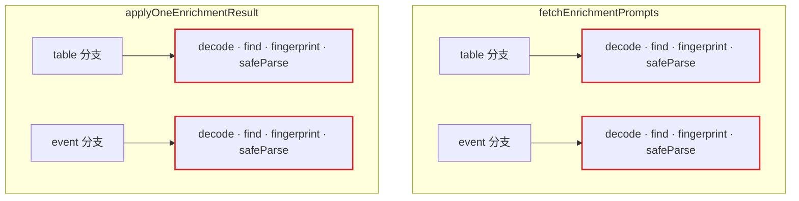
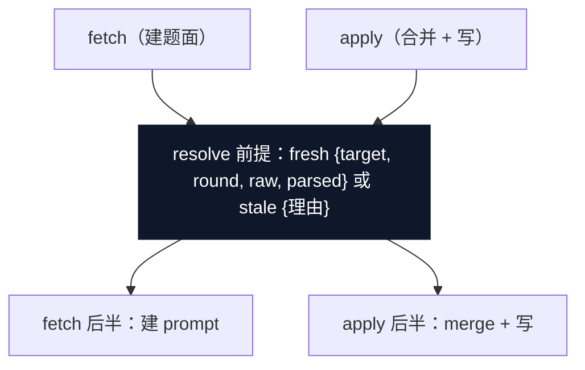

# 2026-10-13 架构巡检报告（improve-codebase-architecture）

**基线** `main e6607fa`（#81 后：substrate 481 / mcp 373 pass + 1 skip / e2e 21 步 / 工具面 27）。
扫描按热点加权（近 200 commit churn：substrate `io.ts`/`index.ts`/enrichment 家族、mcp `tools/*`/`server.ts`/e2e 脚本），三路并行走查（substrate / mcp / 测试拓扑）+ 主会话抽查核验。

**已排除**（不重提）：近两日刚落地项——sweep engine（map #64）、`auditedFileWrite` seam（#61）、读 epoch（map #73）、item 写沉 Core（map #47）、事件文件名迁移（#79/#80）；以及 ADR / map Out-of-scope 记录在案的项（run_enrichment 编排下沉、epoch 外自由函数治理、epoch 可观测性、注销缓存淘汰、多 session 协调、KG 强 schema、跨 scope 参考、域模板）。

**术语**沿用 codebase-design 词表：module / interface / depth / seam / adapter / leverage / locality；deep = 小 interface 背后大行为，shallow = interface 复杂度接近 implementation。图中约定：红色 = 泄漏/漂移，深色 = deep module。

> 交互版 HTML 报告（Tailwind + Mermaid，含手绘 before/after 图）生成于巡检会话的临时目录，未入库；本文件是其 GitHub 可渲染的等价落盘，内容一致并增补健康区清单。

## 候选总览

| # | 候选 | 区域 | 强度 |
|---|---|---|---|
| C1 | item 写 overlay 仪式 6 份手抄 → item-write 内部 module | substrate | **Strong（首推）** |
| C2 | enrichment work fetch/apply 共享前提 4 份镜像 → resolve 步骤 | substrate | Strong |
| C3 | 工具家族描述符：names ↔ registrars 单一来源 | mcp | Strong |
| C4 | 写响应信封 4 种拼法 9+ 组装点 → audited.ts 深模块 | mcp | Strong |
| C5 | 27 个 try/catch + 两份前缀 grep → 收进 epoch Proxy chokepoint | mcp | Strong |
| C6 | guidance/playbook 阶段编排分叉 → 一个评估函数 | mcp | Worth exploring |
| C7 | 测试拓扑三处「合并做了一半」的尾巴 | 测试拓扑 | Strong |
| C8 | 六个小收口（seam 已挣得口粮但没盖满） | 混合 | Worth exploring |

---

## C1 · item 写语义：overlay 仪式 6 份手抄 → 一个内部 module（Strong）

**文件**：`packages/substrate/src/index.ts:1839-2234`（6 处手抄）· `:451-460`（字段配对映射）· `:380-489`（模块级 helper 家族，一个完整"module"住在类定义上方）；参照系 `io.ts:734-754`（`auditedFileWrite` 治过同病的 7→1）。

**Before** —— 「内容字段 + 配对 suppression 字段」的 overlay 仪式在六个 Core item 方法里逐字手抄：

| 方法 | 手抄内容 |
|---|---|
| `addAlias`（:1839-1848） | overlay ≈15 行，gate 手抄 ① |
| `removeAliases`（:1889-1903） | overlay + verdict 三元组，gate ② |
| `addRelation`（:1974-1983） | overlay + veto 路由，gate ③ |
| `removeRelations`（:2042-2065） | overlay + veto 路由 + verdict，gate ④ |
| `addConceptEdge`（:2147-2155） | overlay + veto 路由，gate ⑤ |
| `removeConceptEdges`（:2212-2234） | overlay + verdict 三元组，gate ⑥ |

最微妙的一行是 byte-stability gate：`if (!itemSameStringArray(existingSup, nextSup) || raw[supField] !== undefined)`（:1845 / :1900 / :1980 / :2062 / :2152 / :2231）——「suppression 字段仅在变化或盘上已存在时才进 updates，绝不向从未有过的定义引入 `suppressed_*`」——6 份逐字复制，无独立测试钉住。veto 路由（`machineDerived || !present`）在 :2050-2059 与 :2219-2228 两份近全同；verdict 三元组映射在三份；字段名配对知识散在 `itemSuppressionFieldName`/`itemRelationFieldName`（:451-460）与 `types.ts` 的 schema 配对（:222-223 / :296-297 / :395-396）互为镜像。

**After（plain english）** —— item-write 块（~630 行）抽到自己的内部模块（`enrichment-work.ts` 同款「Core 方法薄转发内部模块函数」先例）：overlay gate / veto 路由 / verdict 构造 / 字段配对各一个家；六个公开方法退化为「读 → 算 next → 调 helper → `applyItemUpdate` → 组装 verdict」。

- locality：gate 与配对不变量一处测试钉死；
- leverage：4 个 MCP item handler 与 Core 公开签名零变化；
- index.ts 2317 → ~1700 行，回到可浏览规模；
- deletion test：真 module——删掉它复杂度要么退回 MCP handler 层（#49 之前）要么重摊 6 份。

**ADR**：无冲突——方法仍在类上，ADR-0002/0003 名字白名单原样；ADR-0010 语义不动。

## C2 · enrichment work：fetch/apply 共享前提 4 份镜像 → resolve 步骤（Strong）

**文件**：`packages/substrate/src/enrichment-work.ts:408-428`（fetch：table/event 两份）· `:593-635`（apply：table/event 两份）· `:370-374`（注释自己承认「fetch 报 stale ⇒ apply 必然 stale」的 guarantee）。

**Before**：

两处都做同一四步（decode → find row → `fingerprint(row.raw) !== baseline` → `safeParse` → 按 round 分派），共 4 份；跨函数 guarantee 只活在注释里，没有任何机制或测试持有。改 stale 条件（`ENRICHMENT_MANAGED_FIELDS` 增删、decode 收紧）要记得改 4 处，漏一处 guarantee 静默变假——agent 在 fetch 拿到的 fresh prompt 白答一轮。今天两份是一致的：这是 locality 缺失，不是正确性 bug。

**After**：

一个内部「resolve target」步骤吃 work_id 返回 fresh 目标或带理由的 stale；fetch/apply 只做各自不同的后半段，table/event 分派与 merge 调用形状的镜像随之消解。work_id 编解码（:157-190）与 fingerprint（:146-150）不动。

- locality：staleness 前提一处定义；
- test：一张表驱动 fixture 同时钉两端；
- leverage：Core 四方法（listEnrichmentWork / getEnrichmentPrompts / applyEnrichmentResults / peekEnrichmentWorkTarget）与 MCP 工具面零变化。

**ADR**：无冲突——ADR-0006 裁决 4 的四 verdict、ADR-0008 的索引/题面分体全保（fetch/apply 仍是两个动词）。

## C3 · 工具家族描述符：names ↔ registrars 单一来源（Strong）

**文件**：`server.ts:156`（`TOOL_REGISTRARS` 手编 5 元数组）· `tools/index.ts:32-72`（`TOOL_NAMES` / `INTENT_TOOL_NAMES` / `INTENT_TOOL_REGISTRARS` 双层手编，:59-65 注释自认 mirror）。
**漂移实证**：`server-startup.spec.ts:358`「twenty-six」（陈旧）· `intent-tools-harness.ts:12/55/86`「twenty-four」×3（#68 加到 27 后没更新）· `check-e2e-loop.ts:246` 步名手列家族=26（漏 #72 的 deregister）· `main.ts:159-161` banner 打 `registrars.length`=8 冒充工具数 27（文档 :148-152 自称报 tool count）。

**Before** —— `TOOL_NAMES`（tools/index.ts 手编 ×2 层）与 `TOOL_REGISTRARS`（server.ts:156 手编）互为镜像，靠 catalog spec 的 tools/list ≡ TOOL_NAMES 对账兜底；工具总数活在 5+ 处散文里，3 处已烂。单一来源只做了一半：names 有单一来源，**names ↔ registrars 的对应关系**没有。

**After（plain english）** —— 每个家族文件导出一个「名字数组 + registrar 函数绑在一起」的描述符（read / write / items / suggestions / scope / enrichment / playbook / import ×8）；`TOOL_NAMES`、`TOOL_REGISTRARS`、banner 的工具计数都从这列描述符导出。大白话：一个家族注册哪些工具，只在一个地方说一次。`toHaveLength(27)` 减速带原样保留（diff 里必须可见）。

- locality：加家族一处编辑（原两文件三处 + 5 处散文对账）；
- mirror 对账测试从「抓漂移」变「结构上不可能漂移」；
- deletion test：现在删掉 `TOOL_NAMES` 无法从 registrars 重建（registrar 不暴露 names）——正是浅的证据；加深后各自可删（都能从描述符导出）。

**ADR**：无冲突——ADR-0013 落地形状明文「按 playbook 家族同款方式并入 TOOL_NAMES/TOOL_REGISTRARS 单一来源组合」，本候选是该裁决的自然延伸，names 内容不动。

## C4 · 写响应信封：4 种拼法 9+ 组装点 → audited.ts 深模块（Strong）

**文件**：`items.ts:51-59`（`itemResponseBase`，4 个工具共用——唯一做对的）· `write.ts:101/126/149`（create 三个 kind 分支各拼一遍，guidanceField 各调一次 :100/:125/:148）+ `:196-202`（update）· `enrichment.ts:264-270 / 348-354`（apply/run）· `import.ts:308-316`。`guidanceField` 共 6 个调用点。

**Before** —— `{scope, commit, changed, [enrichment_health], [_guidance]}` 这个写响应信封有 4 种拼法、9+ 个组装点；`write.ts` 不用已存在的 `itemResponseBase`，证明该 helper 放错了家（在家族文件 items.ts 而非 audited.ts）且形状差一点。`_guidance` 注入（#53 选项 D）当年就是逐点穿透的——ADR-0013 执行细节 5 自认「每工具记得展开」；下一个跨工具响应字段（第 6 个）还要再穿 N 个点。

**After（plain english）** —— audited.ts 增一个「写响应」函数：拿 snapshot + deps + audited 结果 + 写路径类别 + 附加键，一次产出整个信封；`enrichment_health` 的 kind 不对称与 `_guidance` 的 7 工具成员资格（显式名单）都收在里面，工具只剩自己的领域键（verdicts / unsuppressed）。

- locality：响应契约（ADR-0011 R6 的 scope 戳、R8 的 commit/changed、health/guidance 键位规则）归一处；
- leverage：新写工具自动获得正确信封；
- test：guidance 接线测试从 7 个手工用例收敛为信封 1 用例 + 成员资格 1 断言。

**ADR 注意**：显式保留两处已裁决的不对称——import 的 `enrichment_health` 键恒缺（ADR-0013 执行细节）、apply/run_enrichment 不在 `_guidance` 名单（ADR-0014 / #55 R9，7 个 definition 写工具之外的排除是有意的）。参数化即可，不重新诉讼。

## C5 · chokepoint 收编错误映射：删 27 个 try/catch（Strong）

**文件**：`server.ts:196-213`（epoch Proxy；注释 :178-181 明言其存在理由就是反对「赌下一个工具作者记得——ADR-0010 记录过输掉的赌」）· `errors.ts:552-588`（`toToolErrorResult` 返回而非抛，:44-58 实测 SDK 会把 thrown error 剥成裸 `.message`）· 全部 27 个 handler 手写 `try{...}catch(e){return toToolErrorResult(e)}`（read 5 / write 2 / items 4 / suggestions 4 / scope 6 / enrichment 4 / playbook 1 / import 1）· `shared.ts:344-350` 与 `items.ts:38-46` 两份 not-found 前缀 grep（`'Table not found'` 等三前缀 → `DefinitionNotFoundError`）。

**Before** —— 「返回不抛」的 SDK 对策靠每个 handler 手抄 try/catch：工具 #28 作者忘包，coded error 被 SDK 剥成裸 message，无编译期/测试期 tripwire。substrate 改一句错误文案，两份前缀 grep 同时静默失效（症状：Core 错误冒充内部故障，rethrow、无 code）。items 的调用点习语还是双层 try（:121/:150/:179/:208）。

**After（plain english）** —— 既有 Proxy chokepoint 的回调包裹在 Promise 链上做同一映射：SgApplicationError → `toToolErrorResult` 的结果，其余原样抛（内部故障照旧经 SDK 变 isError result，「不假装预期过」语义不变）；not-found 前缀翻译收进一个 substrate→coded adapter（`assertUpdateOk` / `mapCoreError` / `toScopeAwareToolError` 三者退化为它的调用）。handler 体从此不写 try/catch。

- leverage：一个 chokepoint 测试覆盖全部现有 + 未来工具的错误契约；
- locality：SDK 对策与字符串契约各归一处；
- ~54 行纯 ceremony 消失。

**ADR 注意**：ADR-0005（2026-10-09 update）裁的是**机制**（isError result 携 JSON，不走 JSON-RPC error.code），不是「谁包」——实施约定可随实施演进；但 Proxy 同时是 ADR-0015 的 epoch chokepoint，加职责须保 epoch 语义逐字节不变（async 边界小心）。

## C6 · 阶段评估函数：guidance / playbook 编排分叉收拢（Worth exploring）

**文件**：`guidance.ts:95-156` vs `playbook.ts:72-81`（`layerCounts`/`dwPhase`/`kgPhase`/`PHASE_RANK` 四原语已共享 = #63 做对的一半）。
**分叉**：阈值默认 ×2（`guidance.ts:155-156` vs `playbook.ts:261-262`）· laggard 规则 ×2（`guidance.ts:162` 与 `playbook.ts:286-288` 都写 `PHASE_RANK[dw] <= PHASE[kg]`）· `listEnrichmentWork({})` 扫两遍（`guidance.ts:104` + `playbook.ts:269`，后者 :56-61 "Cost note" 自认）· 两张平行散文表（`hintFor` guidance.ts:131-146 vs `recommendedActionFor`+`summaryMessage`+`LAYER_LABEL` playbook.ts:176-224）。

**After（plain english）** —— 一个评估函数（snap + thresholds → {各层 count/phase、laggard、workRemaining、实际阈值}）一次算完；guidance 渲染 `{phase, hint, metrics}`，playbook 渲染 `{layers, summary, overall_phase}`——各自的散文表保留（受众不同是合法差异），键都从同一份评估来；双扫描消失。两工具「永不同意」的等价性从 e2e 巡检（check-e2e-loop.ts:1008-1013）下沉为单元断言。

**ADR**：无冲突——ADR-0014 恰恰 pin 了「一个阶段推导」，本候选是把它做完；4 值/5 值 phase 类型（GuidancePhase vs PlaybookPhase）的诚实分叉保持不动。

## C7 · 测试拓扑：三处「合并做了一半」的尾巴（Strong）

**① substrate 夹具 dict —— 18 个文件手拼全套定义字段**（标记 grep `confirmation: { status: 'draft'` 实测）：`enrichment-work.spec.ts:18,30-52`（注释自认 "mirrors discover-relations.spec's dimDoc/dwsDoc"）· `discover-relations.spec.ts`（被镜像的 origin）· `llm-wiring-integration.spec.ts:24-60` · `bump-completeness.spec.ts:40-60` + 其余 13 个手拼文件；`enrichment-fixtures.ts`（#67 单一来源）只有 4 个 spec 消费。摩擦指标：TableDefinitionSchema 加一个必填字段 = **18 处编辑**；`updateTableMeta` 对合并后文档重校验，缺字段会爆成「看似 recorder bug」（`fixture-corpus.ts:39-44` 原文自证）。
**② mcp 绑定配方 ×3**：`intent-tools-harness.ts:97-115` · `enrichment-tools.spec.ts:189-204`（buildDeps）· `scope-tools.spec.ts:72-78`——同样的「temp registry 路径约定 + 注册 fixture scope + `BindingStore` + `bindStartup` + ServerConfig」，scope-tools 那份少 `bindStartup`，是手工平行而非同源。
**③ e2e**：`check-e2e-loop.ts:914-958 / 966-1019 / 1027-1096` 三份同构 try/finally 探针生命周期样板（漏一个 `rmSync` 就在失败路径漏 temp 目录）；`callCodedError`（:150-161）是 #20 isError 解码规则的第 4 份拷贝（scope-tools :47-64 / enrichment-tools :99-107 / inprocess-client :116-124）。

**After（plain english）** —— 三件事一票做：`enrichment-fixtures.ts` 升级为全域 `fixtureTable()`/`fixtureEvent()`（对应 mcp 侧 `fixtureTable`，spec 只留 load-bearing override，编辑半径 18→2）；harness 导出 `buildFixtureDeps()`（绑定配方 3→1，覆盖 ~50 测试 setup）；e2e `withProbeScope()` 收生命周期 + 解码下沉 `inprocess-client`（4→1），三段 phase 主体逐字不动，净删 ~60 行。

**ADR**：无冲突——k11 静态语料与两条计数钉死 spec（k11-seed / read-count-probe）不动。

## C8 · 小收口清单（Worth exploring，各自独立、按触发挑）

六处「seam 或单一来源已存在但没盖满」的缺口：

1. **epoch 盖 concepts**：`io.ts:394` 的 kind 联合只含 `tables | events`；`loadConcepts`（:445-463）与 `loadRawDir`（:488-503）直读盘——注册 kind 静默落 epoch 外，concept 侧热路径（`itemReadRawDef` concept 分支、`buildGraph`、`get_definition`）保留着逐调用重复解析。k11 实测收益小（10 concepts），结构收益随 concept 写路径增长。需 ADR-0015 addendum；**不得**顺带提 mtime 校验或跨进程缓存（R6/R7 明确否决）。
2. **raw-edit 进 seam**：「写-失效」（无记录半边，`tier2 === undefined` 时的 `atomicWrite + invalidateCaches + return ok`）在 `writeTable`（:794-798）/ `writeEventYaml`（:847-852）/ `writeConceptYaml`（:1002-1007）三份手抄，落在 `auditedFileWrite` 之外；sync 生成约定族（`inferRole`/`generateTableYaml` 等，:1052-1161，唯一 caller 是 `syncWriteDefinitions`）搬出 I/O module。
3. **registry 读半边**：plugin 有 `storageDir` + `schema` 却没有 `load`——events 的 domain 子目录布局逼出 `loadBuiltinDefinitions` 的身份分派（index.ts:866-890，「后注册 kind 不改这里就能上图」的宣称只对扁平布局成立），kind 存储知识一半漏进 Core；`toExecutableRule`（registry.ts:184-187）死成员零引用，窗口内免费删（不在 ADR-0003 保留名单内）；`toPromptContext`/`toCriticContext`/`getId` 只有测试消费，成员收窄在 #79 独立发展定调下重估 dsh 消费证据后再动。
4. **auditedBatch**：`beginBatch → 逐项 record() → end / catch → abort` 手脚架在 `enrichment.ts:316-346` 与 `import.ts:274-299` 各一份（ADR-0013 自认「与 run_enrichment 同构」——同构却各写一份）；只有 2 调用点，回报小于当年 auditedWrite（8 个）。
5. **探针精确钉 → 带宽**：read-count-probe 的 `toBe(321)/toBe(446)/toBe(0)` 是 internal 代价特征；保留 ≤2 / 20× 带宽不变量（真不变量），计数器（`io.ts:156-158` 生产文件里的 test-only 导出）挪 test-only 模块。
6. **known-red 规约化**：#81（`5ae83da`）已清零存量 7+1，mcp 全绿基线 373 pass + 1 skip——剩规约：今后环境性红只能 `it.skipIf(env)` + 行内理由存在，禁止台账 prose（双向腐烂：已修好但台账说红，或新失败被当成「存量之一」跳过追查）。范式已由 #81 给出：env 依赖在 fixture 根上消除（仓库级 git config）+ 语义断言替代拼写断言。

---

## 首推

**C1 · item 写语义深化**：与 #61 在 io.ts 治过的是同一疾病的第二现场——overlay 仪式 6 份手抄、最微妙的 byte-stability gate 无独立测试钉住，下一次手抄（新 kind、新配对字段）抄错 gate 的概率正是 #61 已量化过的那种。抽取形状有仓内先例（enrichment-work.ts 薄转发），公开 interface 零变化（ADR-0002/0003 白名单不动），顺带把 index.ts 从 2317 行降回可浏览规模。**C2 同包同型，可并成一张图（两个 subagent 各管一文件面）。快赢序：C3 最便宜（一处编辑 + 杀掉三类散文漂移），适合当热身。**

## 健康区清单（勿重扫）

- `enrichment/sweep.ts` + `enrichment/types.ts`（sweep engine）：深 module——引擎只持编排，`writePolicy` 是唯一家族分支，deletion test 强通过；四个 wrapper 签名字节稳定。
- `enrichment.ts`（170 行）：诚实的门卫（ADR-0007 door validation）+ 纯 re-export。
- `read-epoch.ts`（102 行）：单一职责、依赖方向显式单向、嵌套 epoch 规则明文。
- `auditedFileWrite` seam（io.ts:734-754）：已验收的 7→1，bump-completeness.spec 钉住。
- `definitionVersion` / `checkExpectedVersion` 指纹往返（io.ts:594-655 ↔ index.ts:1380-1429）：读写两侧同源，by construction 不漂移。
- `snapshot.ts` / `pending.ts` / `metrics.ts` / `corpus.ts` / `relation-graph.ts`：干净的纯投影 / 纯数据结构 module。
- registry 三条核心消费循环（buildGraph / projectGraphNodes / loadRetrievalCorpusAll）：registry 驱动迭代、零 per-kind 分支——seam 的投影半边是真的（3 真 adapter + dsh 消费证据）。
- D5 chokepoint（`this.recorder()` + d5-invariant.spec）：单点强制、有回归测试。
- mcp `server.ts` epoch Proxy chokepoint、`binding.ts` 入口快照（两个同步赋值即全部活状态）、`scope-registry.ts` 三层并发、`git/lock.ts` 双信号活性判定、`git/posture.ts` 四格表、`config.ts` 双载波单一校验。
- mcp `errors.ts`（588 行）：深 module 留下——体量大头是段位账本与 SDK 实测依据，即错误语义的 locality 本身；deletion test 失败（码散落、段位表失去执行点）。
- mcp `tools/audited.ts`（auditedWrite 8 处收敛）、`tools/items.ts`（#49 后真正薄）、`tools/read.ts`（rankDefinitions 独立导出可测）。
- 测试面：`fixture-corpus.ts` 作为 mcp 全域语料基座（12 spec + e2e）；`buildIntentToolHarness` 默认镜像 `TOOL_REGISTRARS`（#57）；`TOOL_NAMES` 三道门对账（catalog / e2e / startup）；e2e 走真 `startup()` + spawn `bin.ts` 验 envelope；`check-core-purity` 空 allowlist 纯不变量门；tarball acceptance specifier-based。

---

*证据均带 file:line，以 `main e6607fa` 为准。*
