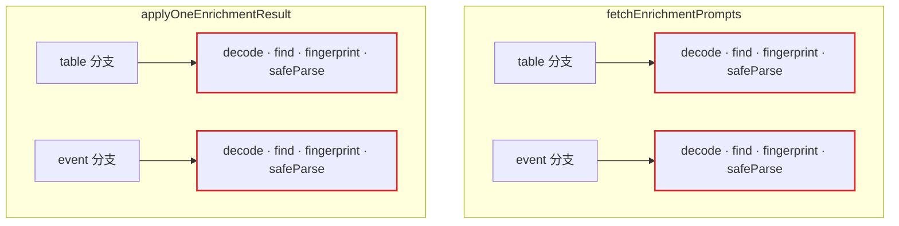
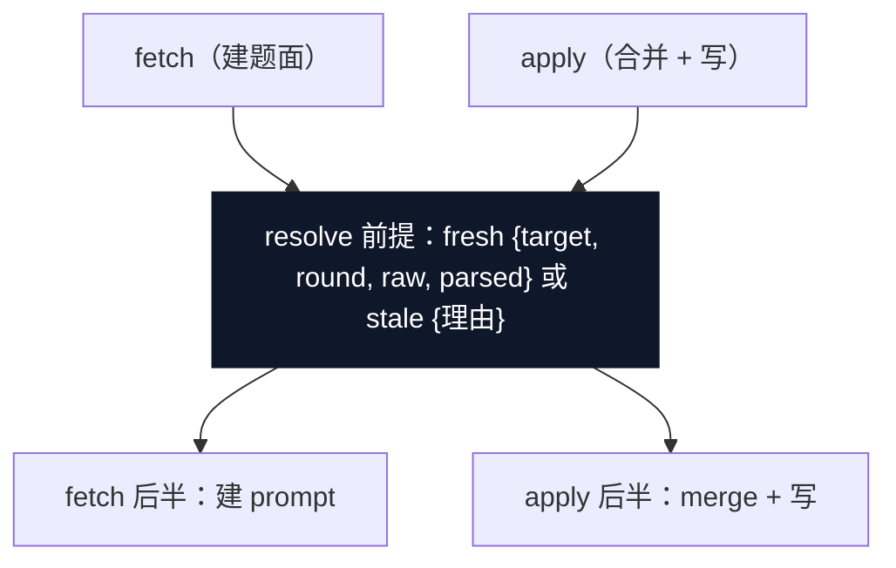

# 2026-10-13 架构巡检报告（improve-codebase-architecture）· 两轴合并版

**基线** `main e6607fa`（#81 后：substrate 481 / mcp 373 pass + 1 skip / e2e 21 步 / 工具面 27）。
扫描按热点加权（近 200 commit churn：substrate `io.ts`/`index.ts`/enrichment 家族、mcp `tools/*`/`server.ts`/e2e 脚本），三路并行走查（substrate / mcp / 测试拓扑）+ 主会话抽查核验。

**已排除**（不重提）：近两日刚落地项——sweep engine（map #64）、`auditedFileWrite` seam（#61）、读 epoch（map #73）、item 写沉 Core（map #47）、事件文件名迁移（#79/#80）；以及 ADR / map Out-of-scope 记录在案的项（run_enrichment 编排下沉、epoch 外自由函数治理、epoch 可观测性、注销缓存淘汰、多 session 协调、KG 强 schema、跨 scope 参考、域模板）。

**术语**沿用 codebase-design 词表：module / interface / depth / seam / adapter / leverage / locality；deep = 小 interface 背后大行为，shallow = interface 复杂度接近 implementation。图中约定：红色 = 泄漏/漂移，深色 = deep module。

> 交互版 HTML 报告（Tailwind + Mermaid，含手绘 before/after 图）生成于巡检会话的临时目录，未入库；本文件是其 GitHub 可渲染的等价落盘，内容一致并增补健康区清单。

> **同日合并（2026-10-13）**：简化巡检（dsh-find-simplifications 方法改查本仓，**删除/收窄轴**）结果并入本报告为 **S 系列**（§S1-S4）。两轴正交——C 系列 = 深化/合并（同样的行为用更少的摊派），S 系列 = 删除/收窄（不再维护没有客户的负担）。S 系列基线 `main 27554fc`（代码与 e6607fa 同树），三域并行子代理巡检（substrate / mcp / 测试+文档）+ 主会话 rg 亲验消费者证据；重叠候选一律交叉标注（§两轴重叠对照），两侧内容均保留未丢弃。C 系列原文未动。

> **落地进度（2026-10-13 晚更新，基线 `main 7f42251`）**：**S1 已全图落地**——[map #88](https://github.com/McKenzieIT/semantic-grounding/issues/88) 五张线性票同日全解（01 LLM seam `abef1d2` / 02 sync-write `3561278` / 03 barrel `ba66229` / 04 scope-epoch `294a1aa` / 05 ADR-0017 + 十张 ADR 体检 + GLOSSARY `c6a1b47`），净删 ~2300 行。连带三处：**C8.2** 搬移半边随 S1.4 整链删除消解，剩 raw-edit「写-失效」三份手抄（现 io.ts:795/849/1004）；**C8.3** 的 `toPromptContext`/`toCriticContext` 已随 S1.6 删（`getId` 仍在 registry.ts:132、`toExecutableRule` 仍在 :172 归 S2、`loadBuiltinDefinitions` 身份分派未动 index.ts:705）；**S3** 的 GLOSSARY:560 矛盾句已随 #87 修。基线刷新：substrate **432** / mcp 373+1skip / e2e 21 / catalog 27 / **barrel 27**。C 系列行号随之漂移（S1 删码所致，**以符号为准**）：C1 六方法现 `index.ts:1556-1909`（文件 2317→2021 行，抽出目标随之改口 ~1700→~1400 级）；C2 四份指纹镜像现 `enrichment-work.ts:411/422/596/622`（文件现 702 行）。**C1+C2 已 charting 为 [map #95](https://github.com/McKenzieIT/semantic-grounding/issues/95)**（带执行图：00 证据复核 → 01 设计裁决 → 02/03 并行落地 → 04 关图；与 map #89 正交）。C3 热身位仍未消费，另起 effort。C4-C8 与 S2/S4 其余项均未动。

> **复核更新（2026-10-14，基线 `main 5e6ce7f`）**：上段两处前瞻已过期——**C1+C2 已关图**（[map #95](https://github.com/McKenzieIT/semantic-grounding/issues/95) 五票同日全解：02 `8dad11b` 新内部模块 `item-write.ts` 651 行〔gate `suppressionJoinsUpdate` / veto `unionVetoKeys` / verdict `removalVerdict` / 字段配对各一个家，index.ts 2021→1517〕、03 `713ee16` `resolveEnrichmentWork` 判别联合〔四镜像收单点 + 表驱动 2 测钉两端〕、04 `a601eef` 终验：公开面零变化五项 + GLOSSARY/ADR 零需求）；**C4 已关图**（[map #106](https://github.com/McKenzieIT/semantic-grounding/issues/106) 四票 2026-10-14 全解：#107 七裁决 → #108 `c0c14da` `writeReceipt` 信封 11 调用点 + 写后 version 回执 → #109 `ede7853` add_* 批量 → #110 `a46fb77` 终验，顺带兑现源票 #103；C4 节首与总览行已随 #110 更新）。其间非巡检票：#102 dogfood 快修、map #89 三张 grilling 已解（#93 ADR-0018 / #94 ADR-0019 / #105 ADR-0005 Update——**#105 裁决新增 `list_definitions` 为第 28 工具，落地票 #112 开放**；其余落地票 #101/#104/#111 亦开放）。基线刷新：substrate **450** / mcp **375+1skip** / e2e 21 / catalog 27 / barrel 27。**余项逐条复核（rg 亲验，行号按 5e6ce7f 刷新）**：C3/C5/C6/C7/S2/S4 证据全部存续（各节首复核行）；C8 余项与 S3 见各自状态注。三处计数漂移：C7① 夹具 dict 18→**14** 文件（S1 删测试段所致，摩擦仍实）；S4 的 `ApplyResult` 经 #108 添 `version` 键，与 `UpdateResult` 由「同形」变「近形」（合并建议仍立）；C8.5 探针计数已常量化（`K11_TABLES`/`K11_EVENT_READS`，精确钉性质未变）。

## 候选总览

| # | 候选 | 区域 | 强度 |
|---|---|---|---|
| C1 | item 写 overlay 仪式 6 份手抄 → item-write 内部 module | substrate | **Strong（首推）· 已落地**（[map #95](https://github.com/McKenzieIT/semantic-grounding/issues/95) 五票 2026-10-13 同日全解关图：02 `8dad11b` `item-write.ts` 651 行新家〔gate/veto/verdict/字段配对各一个家〕，index.ts 2021→1517） |
| C2 | enrichment work fetch/apply 共享前提 4 份镜像 → resolve 步骤 | substrate | **Strong · 已落地**（map #95 03 `713ee16` `resolveEnrichmentWork` 单点，「fetch 报 stale ⇒ apply 必然 stale」从注释升机制 + 表驱动钉两端） |
| C3 | 工具家族描述符：names ↔ registrars 单一来源 | mcp | **Strong · 已落地**（[map #113](https://github.com/McKenzieIT/semantic-grounding/issues/113) 三票 2026-10-14 全解关图：#114 裁决四问全签 → 02 `81b05ec` 九家族两键卡片 {names,register} 住家族文件〔`ToolFamily` 住 tools/shared.ts〕，index.ts 双层列表派生四常量，server.ts 改 import 派生再导出 + S3 散文六处一票修、`toHaveLength(29)` 减速带显式保留） |
| C4 | 写响应信封 4 种拼法 9+ 组装点 → audited.ts 深模块 | mcp | **Strong · 已落地**（[map #106](https://github.com/McKenzieIT/semantic-grounding/issues/106) 四票 2026-10-14 全解关图：`writeReceipt` 信封 11 调用点收编 + 写后 version 回执 + add_* 批量〔#108 `c0c14da` / #109 `ede7853`〕，rg 单点验证与公开面白名单对账落 #110 resolution） |
| C5 | 27 个 try/catch + 两份前缀 grep → 收进 epoch Proxy chokepoint | mcp | **Strong · 已落地**（[map #118](https://github.com/McKenzieIT/semantic-grounding/issues/118) 六票 2026-10-14 全解关图：#119 裁决四问 → #120 `16e2a4a` `epochWrapped` 门内 Promise 链映射〔Sg→`toToolErrorResult` 结果、其余原样抛；substrate 零文件 = epoch 逐字节不变〕+ not-found adapter 家族住 errors.ts；handler 手抄 catch-return 实数 **29** 清零〔票面 30→#119 计 31→终核 29〕；chokepoint 单点断言一处盖全部） |
| C6 | guidance/playbook 阶段编排分叉 → 一个评估函数 | mcp | Worth exploring · **已落地**（map #118 #121 `55bc05f` `evaluateLayers` 住 guidance.ts 单点——阈值默认/laggard 判式/`listEnrichmentWork({})` 全语料扫各生产唯一点、双扫消失；双渲染器共享同一评估对象零判断分叉、两工具响应键值逐字不变；等价性单元断言 +5 测试） |
| C7 | 测试拓扑三处「合并做了一半」的尾巴 | 测试拓扑 | **Strong · 已落地**（map #118 #122 `0b5e93e`〔rebase 后终 sha，pre-rebase 39fc550〕：①`fixtureTable`/`fixtureEvent` 单点、13 spec 手拼清零〔`primary_key_unique` 测试面只剩 fixtures〕②绑定配方 4→1〔`buildFixtureDeps`+`freshFixtureRegistry`；勘误：第 4 位是 scope-tools 非 server-startup〕③e2e `withProbeScope` 生命周期单点 + isError 解码 `decodeResult` 单 decode 两出口四消费位；零生产码、k11 语料零改动） |
| C8 | 六个小收口（seam 已挣得口粮但没盖满） | 混合 | Worth exploring · **已落地（择项）**（map #118 #123 `25b26ac`〔rebase 后终 sha，pre-rebase d6054c8〕：C8.1 no-go 边界注释 / C8.2 `writeDefinitionFile` 写分发单 seam 三调用点 / C8.4 `withAuditedBatch` 单点 / C8.5 计数三件套挪 `io-probes.ts` 不进 barrel + 精确钉→带宽不变量 + S4 三小件同票〔toolSuccess/entryHead 惰性/switchTo 双跑减半〕；C8.3 死成员归 S2 另票、C8.6 已随 #81 除名——见节内状态注） |
| S1 | dsh 姿态面集群：snapshot / LLM seam / SchemaProvider / sync-write 链 / barrel 收窄 / scope-epoch | substrate+mcp | Strong 证据 · **已落地**（[#82](https://github.com/McKenzieIT/semantic-grounding/issues/82) 六项裁决 → [map #88](https://github.com/McKenzieIT/semantic-grounding/issues/88) 五票 2026-10-13 同日全解关图，ADR-0017 accepted；S1.1/S1.3 暂缓进 ADR-0017） |
| S2 | A 类死码 ~650 行（vendor 三件套 / loadDomains / recorder 预留字段 / 死导出） | 混合 | 免费（直删，零行为损失）· **复核 2026-10-14：八条目 + 弱 A 逐一 rg 全存续**（recorder 已迁 `src/git/recorder.ts`） |
| S3 | 文档/注释漂移（README 工具数 26→27 契约行等） | docs | 修字（部分与 C3 重叠）· **复核 2026-10-14 仍成立**（README:100 仍 26〔现值应 27、#112 后 28〕；旧路径头注实为 **4** 处，巡检漏计 corpus.spec.ts:7） |
| S4 | 小粒度整合 + 段位挪用（−31024） | mcp | 顺手批（部分与 C5/C6/C8 重叠）· **复核 2026-10-14 六条全存续**（`ApplyResult` 添 version，「同形」变「近形」，合并仍立） |

---

## C1 · item 写语义：overlay 仪式 6 份手抄 → 一个内部 module（Strong）——已落地（map #95，2026-10-13 `8dad11b`）

**文件**：`packages/substrate/src/index.ts:1839-2234`（6 处手抄）· `:451-460`（字段配对映射）· `:380-489`（模块级 helper 家族，一个完整"module"住在类定义上方）；参照系 `io.ts:734-754`（`auditedFileWrite` 治过同病的 7→1）。

**Before** —— 「内容字段 + 配对 suppression 字段」的 overlay 仪式在六个 Core item 方法里逐字手抄：

| 方法 | 手抄内容 |
|---|---|
| `addAlias`（:1839-1848） | overlay ≈15 行，gate 手抄 ① |
| `removeAliases`（:1889-1903） | overlay + verdict 三元组，gate ② |
| `addRelation`（:1974-1983） | overlay + veto 路由，gate ③ |
| `removeRelations`（:2042-2065） | overlay + veto 路由 + verdict，gate ④ |
| `addConceptEdge`（:2147-2155） | overlay + veto 路由，gate ⑤ |
| `removeConceptEdges`（:2212-2234） | overlay + verdict 三元组，gate ⑥ |

最微妙的一行是 byte-stability gate：`if (!itemSameStringArray(existingSup, nextSup) || raw[supField] !== undefined)`（:1845 / :1900 / :1980 / :2062 / :2152 / :2231）——「suppression 字段仅在变化或盘上已存在时才进 updates，绝不向从未有过的定义引入 `suppressed_*`」——6 份逐字复制，无独立测试钉住。veto 路由（`machineDerived || !present`）在 :2050-2059 与 :2219-2228 两份近全同；verdict 三元组映射在三份；字段名配对知识散在 `itemSuppressionFieldName`/`itemRelationFieldName`（:451-460）与 `types.ts` 的 schema 配对（:222-223 / :296-297 / :395-396）互为镜像。

**After（plain english）** —— item-write 块（~630 行）抽到自己的内部模块（`enrichment-work.ts` 同款「Core 方法薄转发内部模块函数」先例）：overlay gate / veto 路由 / verdict 构造 / 字段配对各一个家；六个公开方法退化为「读 → 算 next → 调 helper → `applyItemUpdate` → 组装 verdict」。

- locality：gate 与配对不变量一处测试钉死；
- leverage：4 个 MCP item handler 与 Core 公开签名零变化；
- index.ts 2317 → ~1700 行，回到可浏览规模；
- deletion test：真 module——删掉它复杂度要么退回 MCP handler 层（#49 之前）要么重摊 6 份。

**ADR**：无冲突——方法仍在类上，ADR-0002/0003 名字白名单原样；ADR-0010 语义不动。

## C2 · enrichment work：fetch/apply 共享前提 4 份镜像 → resolve 步骤（Strong）——已落地（map #95，2026-10-13 `713ee16`）

**文件**：`packages/substrate/src/enrichment-work.ts:408-428`（fetch：table/event 两份）· `:593-635`（apply：table/event 两份）· `:370-374`（注释自己承认「fetch 报 stale ⇒ apply 必然 stale」的 guarantee）。

**Before**：

两处都做同一四步（decode → find row → `fingerprint(row.raw) !== baseline` → `safeParse` → 按 round 分派），共 4 份；跨函数 guarantee 只活在注释里，没有任何机制或测试持有。改 stale 条件（`ENRICHMENT_MANAGED_FIELDS` 增删、decode 收紧）要记得改 4 处，漏一处 guarantee 静默变假——agent 在 fetch 拿到的 fresh prompt 白答一轮。今天两份是一致的：这是 locality 缺失，不是正确性 bug。

**After**：

一个内部「resolve target」步骤吃 work_id 返回 fresh 目标或带理由的 stale；fetch/apply 只做各自不同的后半段，table/event 分派与 merge 调用形状的镜像随之消解。work_id 编解码（:157-190）与 fingerprint（:146-150）不动。

- locality：staleness 前提一处定义；
- test：一张表驱动 fixture 同时钉两端；
- leverage：Core 四方法（listEnrichmentWork / getEnrichmentPrompts / applyEnrichmentResults / peekEnrichmentWorkTarget）与 MCP 工具面零变化。

**ADR**：无冲突——ADR-0006 裁决 4 的四 verdict、ADR-0008 的索引/题面分体全保（fetch/apply 仍是两个动词）。

## C3 · 工具家族描述符：names ↔ registrars 单一来源（Strong）——已落地（map #113，2026-10-14 `81b05ec`）

> **落地核验（2026-10-14，#116 终验）**：九家族两键卡片 `X_TOOL_FAMILY: ToolFamily`（names 数组与 register 函数绑在一起）各住其家族文件（`ToolFamily` 类型住 `tools/shared.ts`，type-only 引 `ToolRegistrar` 无运行时环）；`tools/index.ts` 以 `INTENT_TOOL_FAMILIES`（read/write/items/suggestions）+ `TOOL_FAMILIES`（+enrichment/scope/playbook/import/scratch）双层列表 flatMap/map 派生 `TOOL_NAMES`·`INTENT_TOOL_NAMES`·`INTENT_TOOL_REGISTRARS`·`TOOL_REGISTRARS` 四常量；`server.ts` 改 import 派生 `TOOL_REGISTRARS` 再导出，手编 5 元数组与「mirror 自认」注释整块重写——names ↔ registrars 漂移从「catalog spec 抓到」变「结构上不可能」。banner 工具计数参数化（`startupBanner(result, toolCount)`，main 默认路径传 `TOOL_NAMES.length`，自定义面经 `ServeOptions.toolCount` 自报）。S3 散文六处照 #114 Q4 裁决一票修（README 契约行硬 29 +「权威 = banner `tools:` 行」指向句、:98 删「registrar 函数数」概念、harness 三处派生表述、e2e 步名「≡ TOOL_NAMES」、server-startup:358 已在 29 零改动存档）；`toHaveLength(29)` 减速带显式保留（显式字面量，81b05ec 未触碰）；`TOOL_NAMES` 类型放宽 `readonly string[]` 为唯一公共面涟漪。门禁：typecheck 双包 0 / substrate 450 / mcp 433+1skip / e2e 22（banner 实报 tools: 29）。

> **复核（2026-10-14，`main 5e6ce7f`）**：漂移证据全部存续（行号微移）——`server-startup.spec.ts:358`「twenty-six」· `intent-tools-harness.ts:12/55/86`「twenty-four」×3 · `check-e2e-loop.ts:246` 步名家族枚举仍漏 #72 的 deregister（加总 26）· `intent-tools-catalog.spec.ts:22` 注释自称 `toHaveLength(26)` 与 `:72` 断言 27 自矛盾 · `main.ts:159-161` banner 仍打 `registrars.length`（「8 registrar(s)」）· README.md:100 仍「应报 26」。`server.ts:156` 与 `tools/index.ts` 镜像结构、自认 mirror 的注释原样。**收益放大**：#105 已裁决第 28 工具 `list_definitions`（落地票 [#112](https://github.com/McKenzieIT/semantic-grounding/issues/112) 开放）——26→27（#72）后又一次扩面，五处散文每加一工具都要再碰一遍；若与 #112 同批落 C3，扩面编辑半径一处化，catalog 减速带同票改 28。

**文件**：`server.ts:156`（`TOOL_REGISTRARS` 手编 5 元数组）· `tools/index.ts:32-72`（`TOOL_NAMES` / `INTENT_TOOL_NAMES` / `INTENT_TOOL_REGISTRARS` 双层手编，:59-65 注释自认 mirror）。〔以上为巡检时点行号，落地后以 `X_TOOL_FAMILY` 描述符卡片与 `TOOL_FAMILIES` 派生常量为准。〕
**漂移实证**：`server-startup.spec.ts:358`「twenty-six」（陈旧）· `intent-tools-harness.ts:12/55/86`「twenty-four」×3（#68 加到 27 后没更新）· `check-e2e-loop.ts:246` 步名手列家族=26（漏 #72 的 deregister）· `main.ts:159-161` banner 打 `registrars.length`=8 冒充工具数 27（文档 :148-152 自称报 tool count）。

**Before** —— `TOOL_NAMES`（tools/index.ts 手编 ×2 层）与 `TOOL_REGISTRARS`（server.ts:156 手编）互为镜像，靠 catalog spec 的 tools/list ≡ TOOL_NAMES 对账兜底；工具总数活在 5+ 处散文里，3 处已烂。单一来源只做了一半：names 有单一来源，**names ↔ registrars 的对应关系**没有。

**After（plain english）** —— 每个家族文件导出一个「名字数组 + registrar 函数绑在一起」的描述符（read / write / items / suggestions / scope / enrichment / playbook / import ×8）；`TOOL_NAMES`、`TOOL_REGISTRARS`、banner 的工具计数都从这列描述符导出。大白话：一个家族注册哪些工具，只在一个地方说一次。`toHaveLength(27)` 减速带原样保留（diff 里必须可见）。

- locality：加家族一处编辑（原两文件三处 + 5 处散文对账）；
- mirror 对账测试从「抓漂移」变「结构上不可能漂移」；
- deletion test：现在删掉 `TOOL_NAMES` 无法从 registrars 重建（registrar 不暴露 names）——正是浅的证据；加深后各自可删（都能从描述符导出）。

**ADR**：无冲突——ADR-0013 落地形状明文「按 playbook 家族同款方式并入 TOOL_NAMES/TOOL_REGISTRARS 单一来源组合」，本候选是该裁决的自然延伸，names 内容不动。

## C4 · 写响应信封：4 种拼法 9+ 组装点 → audited.ts 深模块（Strong）——已落地（map #106，2026-10-14 `c0c14da`）

> **落地核验（2026-10-14，#110 终验）**：`writeReceipt(snap, deps, res, {tool, writePath, version?, domain?})` 落 audited.ts，收编全部组装点（items 4 / write 4 / enrichment 2 / import 1 = 11 调用）；`guidanceField`/`itemResponseBase` 死码清零，`enrichment_health` 组装与 `_guidance` 注入均单点（rg 实证）；guidance 接线测试 7 手工用例 → 信封 1 + 成员资格 1（`GUIDANCE_TOOL_NAMES` 显式名单导出）。两处已裁决不对称原样保留并参数化（import 恒缺 / apply·run 不在名单）；执行核正第三处——create 族无钩子，writePath 添 `'create'` 值保住 create_table 的 health 键缺席（ADR-0005 裁决 5）。信封顺带成为 #103 写后 version 回执的单点落位（io 六写原语带指纹、Core 钩子后重读、import 行级），#109 的 add_* 批量回执同走此信封。

**文件**：`items.ts:51-59`（`itemResponseBase`，4 个工具共用——唯一做对的）· `write.ts:101/126/149`（create 三个 kind 分支各拼一遍，guidanceField 各调一次 :100/:125/:148）+ `:196-202`（update）· `enrichment.ts:264-270 / 348-354`（apply/run）· `import.ts:308-316`。`guidanceField` 共 6 个调用点。〔以上为巡检时点行号，落地后以 `writeReceipt` 符号为准。〕

**Before** —— `{scope, commit, changed, [enrichment_health], [_guidance]}` 这个写响应信封有 4 种拼法、9+ 个组装点；`write.ts` 不用已存在的 `itemResponseBase`，证明该 helper 放错了家（在家族文件 items.ts 而非 audited.ts）且形状差一点。`_guidance` 注入（#53 选项 D）当年就是逐点穿透的——ADR-0013 执行细节 5 自认「每工具记得展开」；下一个跨工具响应字段（第 6 个）还要再穿 N 个点。

**After（plain english）** —— audited.ts 增一个「写响应」函数：拿 snapshot + deps + audited 结果 + 写路径类别 + 附加键，一次产出整个信封；`enrichment_health` 的 kind 不对称与 `_guidance` 的 7 工具成员资格（显式名单）都收在里面，工具只剩自己的领域键（verdicts / unsuppressed）。

- locality：响应契约（ADR-0011 R6 的 scope 戳、R8 的 commit/changed、health/guidance 键位规则）归一处；
- leverage：新写工具自动获得正确信封；
- test：guidance 接线测试从 7 个手工用例收敛为信封 1 用例 + 成员资格 1 断言。

**ADR 注意**：显式保留两处已裁决的不对称——import 的 `enrichment_health` 键恒缺（ADR-0013 执行细节）、apply/run_enrichment 不在 `_guidance` 名单（ADR-0014 / #55 R9，7 个 definition 写工具之外的排除是有意的）。参数化即可，不重新诉讼。

## C5 · chokepoint 收编错误映射：删 27 个 try/catch（Strong）——已落地（map #118，2026-10-14 `16e2a4a`）

> **落地核验（2026-10-14，#124 终验）**：`epochWrapped`（server.ts:179）`outcome.catch(toToolErrorResult)` 为全包唯一生产调用点（index.ts re-export 非调用）；handler 手抄 catch-return **29 处**清零〔计数终核：票面 30 → #119 计 31 → #120 勘误 29——enrichment「4 直抄 + 2 站位」系双计；pre-image 逐文件复数吻合：read 6 / write 2 / items 4 双层 / suggestions 4 / scope 6 / enrichment 4 / playbook 1 / import 1 / scratch 1，另排除 enrichment/import 两处 Q4 裁决保留的 `batch.abort` catch（后随 #123 `withAuditedBatch` 收编）与 scope/scratch 两处 best-effort 非映射〕；16e2a4a 17 文件全在 mcp = substrate 零改动、epoch 逐字节不变红线兑现；三前缀 `startsWith` 唯一定义 errors.ts `isSubstrateNotFound`（`SUBSTRATE_NOT_FOUND_PREFIXES`），`notFoundAsCoded`（items 承诺链 ×4）/`unknownFilterNamesAsCoded`（enrichment 承诺链 + `assertKnownFilterNamesCoded` 翻译层）就位，`assertUpdateOk` 退化调用、`mapCoreError`/`toScopeAwareToolError` 退役；错误契约测试一处盖全部（tool-error-contract.spec：async throw Sg → `expect(res.result).toEqual(toToolErrorResult(coded))` 逐字段 + 非 Sg 裸 message 镜像钉 + adapter 单测 5 条；MCP 层写中途/并发世代补钉新 spec `read-epoch-midwrite-concurrent.spec`）。

> **复核（2026-10-14）**：原样存续——27 个 handler try/catch 精确同数（`return toToolErrorResult(e)` 逐文件计数 + items 变体）；`toToolErrorResult` 现 `errors.ts:571`；两份 not-found 前缀 grep 现 `shared.ts:346` / `items.ts:40`。工具面 27 未变（#112 未落地），计数无需刷新。

**文件**：`server.ts:196-213`（epoch Proxy；注释 :178-181 明言其存在理由就是反对「赌下一个工具作者记得——ADR-0010 记录过输掉的赌」）· `errors.ts:552-588`（`toToolErrorResult` 返回而非抛，:44-58 实测 SDK 会把 thrown error 剥成裸 `.message`）· 全部 27 个 handler 手写 `try{...}catch(e){return toToolErrorResult(e)}`（read 5 / write 2 / items 4 / suggestions 4 / scope 6 / enrichment 4 / playbook 1 / import 1）· `shared.ts:344-350` 与 `items.ts:38-46` 两份 not-found 前缀 grep（`'Table not found'` 等三前缀 → `DefinitionNotFoundError`）。〔以上为巡检时点行号，落地后以 `epochWrapped`（server.ts）与 errors.ts adapter 家族符号为准。〕

**Before** —— 「返回不抛」的 SDK 对策靠每个 handler 手抄 try/catch：工具 #28 作者忘包，coded error 被 SDK 剥成裸 message，无编译期/测试期 tripwire。substrate 改一句错误文案，两份前缀 grep 同时静默失效（症状：Core 错误冒充内部故障，rethrow、无 code）。items 的调用点习语还是双层 try（:121/:150/:179/:208）。

**After（plain english）** —— 既有 Proxy chokepoint 的回调包裹在 Promise 链上做同一映射：SgApplicationError → `toToolErrorResult` 的结果，其余原样抛（内部故障照旧经 SDK 变 isError result，「不假装预期过」语义不变）；not-found 前缀翻译收进一个 substrate→coded adapter（`assertUpdateOk` / `mapCoreError` / `toScopeAwareToolError` 三者退化为它的调用）。handler 体从此不写 try/catch。

- leverage：一个 chokepoint 测试覆盖全部现有 + 未来工具的错误契约；
- locality：SDK 对策与字符串契约各归一处；
- ~54 行纯 ceremony 消失。

**ADR 注意**：ADR-0005（2026-10-09 update）裁的是**机制**（isError result 携 JSON，不走 JSON-RPC error.code），不是「谁包」——实施约定可随实施演进；但 Proxy 同时是 ADR-0015 的 epoch chokepoint，加职责须保 epoch 语义逐字节不变（async 边界小心）。

## C6 · 阶段评估函数：guidance / playbook 编排分叉收拢（Worth exploring）——已落地（map #118，2026-10-14 `55bc05f`）

> **落地核验（2026-10-14，#124 终验）**：`evaluateLayers(snap, thresholds?)` 住 guidance.ts 单点——`?? DEFAULT_DW/KG_THRESHOLD` 应用（:185-186）、`PHASE_RANK[...] <= PHASE_RANK[...]` laggard 判式（:193）、`listEnrichmentWork({})` 全语料扫（:190）各全包生产唯一点（rg 复核；enrichment.ts:200 的 `listEnrichmentWork(filterOpts(args))` 是 `get_enrichment_work` 工具本体带过滤读、非分叉——判断复核成立）；`guidanceFromEvaluation`/`playbookFromEvaluation` 双渲染器共享同一 `LayersEvaluation` 零判断分叉，两工具响应键值逐字不变（既有 spec 零改动全绿佐证）、e2e Phase 6.6 零改动；等价性单元断言在位（guidance.spec：同一评估对象驱动两渲染器断 `overall_phase === _guidance.phase` + `layers.*.phase === metrics.*.phase`，盖 6 状态 + override 2 态，另单次扫描/生效阈值/laggard tie→DW 钉）；随势收编：`dwPhase`/`kgPhase`/`PHASE_RANK` 收回模块私有（#63 导出理由消灭）、`layerCounts` 仍导出（scope.ts 消费）、均非 barrel 面。

> **复核（2026-10-14）**：四分叉全存续——阈值默认独立（`playbook.ts:257` 注释自认 "each side defaults independently"）· laggard 规则 ×2（`guidance.ts:166` 与 `playbook.ts:286-290` 同判式）· `listEnrichmentWork({})` 双扫（`guidance.ts:105` + `playbook.ts:269`）· 两张平行散文表。#102 的 get_scope counts 复用 `layerCounts` 共享原语，未触分叉。未动。

**文件**：`guidance.ts:95-156` vs `playbook.ts:72-81`（`layerCounts`/`dwPhase`/`kgPhase`/`PHASE_RANK` 四原语已共享 = #63 做对的一半）。
**分叉**：阈值默认 ×2（`guidance.ts:155-156` vs `playbook.ts:261-262`）· laggard 规则 ×2（`guidance.ts:162` 与 `playbook.ts:286-288` 都写 `PHASE_RANK[dw] <= PHASE[kg]`）· `listEnrichmentWork({})` 扫两遍（`guidance.ts:104` + `playbook.ts:269`，后者 :56-61 "Cost note" 自认）· 两张平行散文表（`hintFor` guidance.ts:131-146 vs `recommendedActionFor`+`summaryMessage`+`LAYER_LABEL` playbook.ts:176-224）。〔以上为巡检时点行号，落地后以 `evaluateLayers`/`guidanceFromEvaluation`/`playbookFromEvaluation` 符号为准。〕

**After（plain english）** —— 一个评估函数（snap + thresholds → {各层 count/phase、laggard、workRemaining、实际阈值}）一次算完；guidance 渲染 `{phase, hint, metrics}`，playbook 渲染 `{layers, summary, overall_phase}`——各自的散文表保留（受众不同是合法差异），键都从同一份评估来；双扫描消失。两工具「永不同意」的等价性从 e2e 巡检（check-e2e-loop.ts:1008-1013）下沉为单元断言。

**ADR**：无冲突——ADR-0014 恰恰 pin 了「一个阶段推导」，本候选是把它做完；4 值/5 值 phase 类型（GuidancePhase vs PlaybookPhase）的诚实分叉保持不动。

## C7 · 测试拓扑：三处「合并做了一半」的尾巴（Strong）——已落地（map #118，2026-10-14 `0b5e93e`）

> **落地核验（2026-10-14，#124 终验）**：①`fixtureTable()`/`fixtureEvent()` 住 enrichment-fixtures.ts（fixtureEvent 走 `EventDefinitionSchema.parse` 共享 schema 默认），13 个手拼 spec（10 全套 + 3 部分）改走 builder 只留 load-bearing override——rg `primary_key_unique` 测试面唯 fixtures 单点（余为 k11 静态语料 YAML，diff 核零改动），schema 加必填字段编辑半径 13 处 spec → 1 文件 2 builder；②harness 导出 `buildFixtureDeps()` + `freshFixtureRegistry()`，全套配方 4 位（harness/enrichment-tools/binding/scope-tools——**勘误：第 4 位是 scope-tools 非 server-startup**，后者只有路径半件也经 freshFixtureRegistry 归一）全走单点；残留 `new BindingStore`/`new ScopeRegistryFile` 均被测对象本体语义测试（binding.spec 锁/logger 契约、scope-registry.spec ENOENT、server-startup `registerDirect` 姿态绕行钉），非配方；③e2e 三段 try/finally 探针收 `withProbeScope()` 单点生命周期、三段 phase 主体逐字不动（22 步恒定）；#20 isError 解码收 inprocess-client `decodeResult` 单 decode + `toolOutcome`（JSON-RPC 信封）/`handlerOutcome`（直连 handler）两出口，e2e `callCodedError`/enrichment `call`/scope `callOk`/playbook `codedErrorOf` 四消费位统一——剩余 `res.result?.['isError']` 均对已持原始响应的单旗布尔断言、非解码重实现（判断复核成立）；零生产码（22 文件 diff 全在 tests/scripts）、k11-seed/read-count-probe/静态语料零改动。

> **复核（2026-10-14）**：三尾巴全在，仅①计数缩小——①标记 grep `confirmation: { status: 'draft'` 现 **14** 个 spec 文件（18→14：S1 删测试段带走部分手拼文件，#98 `item-write.spec` / #52 `concept-write.spec` 为其后新增仍手拼；`enrichment-fixtures.ts` 单一来源消费面未扩）；②三份绑定配方原样（harness `:102-103` 有 `bindStartup` / enrichment-tools `:189` 起 / scope-tools `:72-78` 仍缺）；③`callCodedError` 仍 `check-e2e-loop.ts:150`（#20 解码规则第 4 份拷贝），三段 try/finally 探针样板原样（#72 在 probe 步内插入 deregister 观测，未收生命周期）。

**① substrate 夹具 dict —— 18 个文件手拼全套定义字段**（标记 grep `confirmation: { status: 'draft'` 实测）：`enrichment-work.spec.ts:18,30-52`（注释自认 "mirrors discover-relations.spec's dimDoc/dwsDoc"）· `discover-relations.spec.ts`（被镜像的 origin）· `llm-wiring-integration.spec.ts:24-60` · `bump-completeness.spec.ts:40-60` + 其余 13 个手拼文件；`enrichment-fixtures.ts`（#67 单一来源）只有 4 个 spec 消费。摩擦指标：TableDefinitionSchema 加一个必填字段 = **18 处编辑**；`updateTableMeta` 对合并后文档重校验，缺字段会爆成「看似 recorder bug」（`fixture-corpus.ts:39-44` 原文自证）。
**② mcp 绑定配方 ×3**：`intent-tools-harness.ts:97-115` · `enrichment-tools.spec.ts:189-204`（buildDeps）· `scope-tools.spec.ts:72-78`——同样的「temp registry 路径约定 + 注册 fixture scope + `BindingStore` + `bindStartup` + ServerConfig」，scope-tools 那份少 `bindStartup`，是手工平行而非同源。
**③ e2e**：`check-e2e-loop.ts:914-958 / 966-1019 / 1027-1096` 三份同构 try/finally 探针生命周期样板（漏一个 `rmSync` 就在失败路径漏 temp 目录）；`callCodedError`（:150-161）是 #20 isError 解码规则的第 4 份拷贝（scope-tools :47-64 / enrichment-tools :99-107 / inprocess-client :116-124）。

**After（plain english）** —— 三件事一票做：`enrichment-fixtures.ts` 升级为全域 `fixtureTable()`/`fixtureEvent()`（对应 mcp 侧 `fixtureTable`，spec 只留 load-bearing override，编辑半径 18→2）；harness 导出 `buildFixtureDeps()`（绑定配方 3→1，覆盖 ~50 测试 setup）；e2e `withProbeScope()` 收生命周期 + 解码下沉 `inprocess-client`（4→1），三段 phase 主体逐字不动，净删 ~60 行。

**ADR**：无冲突——k11 静态语料与两条计数钉死 spec（k11-seed / read-count-probe）不动。

## C8 · 小收口清单（Worth exploring，各自独立、按触发挑）——已落地（择项，map #118 #123，2026-10-14 `25b26ac`）

> **落地核验（2026-10-14，#124 终验）**：**1** no-go 落显性边界注释（`readThroughEpoch` 文档处：kind 联合恒 `'tables' | 'events'`、concepts 与 plugin kinds〔`loadRawDir` 路径〕刻意世代外，指回 #119 裁决 + 重开触发器〔concept 写路径批量化或 concepts>100〕 + R6/R7 禁区重申；零行为、无 ADR-0015 addendum）。**2** `writeDefinitionFile` 单 seam（io.ts:820）与 `auditedFileWrite` 分层不撕裂——writeTable/writeEventYaml/writeConceptYaml 三调用点（:881/:930/:1083）缩「验证+算路径+一行调用」，raw 分发对（atomicWrite+invalidateCaches :828-829）全模块唯一，version 回执内联保留、形状零变化。**3** 本图不动（`toExecutableRule` 归 S2 清理票、`getId`/`loadBuiltinDefinitions` 归 00 Q4 议程——见条内状态注）。**4** `withAuditedBatch`（audited.ts:143）begin→循环 record→end、catch→abort→rethrow 单点（`beginBatch()`/`.abort()` 生产唯一点），enrichment/import 两调用点一行包裹。**5** 计数三件套挪 `substrate/src/io-probes.ts`（不进 barrel——对源码与 tsdown 构建产物双 deepEqual 27+default、探针零泄漏），io.ts 只剩 import + 一行增量（:55/:147）；read-count-probe 精确钉改带宽不变量（单定义读 ≤2× 本 kind 语料、整操作 <20× 全语料、写路径 ≤2 原样），K11 常量留 spec 侧当带宽算子。**6** 已随 #81 除名。同票捎 **S4 三小件**：toolSuccess 收敛（read 9 + suggestions 4 内联清零，响应形状全域单点）、entryHead 惰性（有 commit 不付 rev-parse；回退读卡位 fn 后/derived-residue 提交前——该提交不入 window.commits，注释钉）、switchTo/bindStartup posture 双跑减半（report 线程穿 `bindingFor`，错误类别与拒绝行为零变化）。终验门禁亲跑：typecheck 双包 0 / substrate 450 / mcp 446+1skip / e2e 22（banner 29）。

六处「seam 或单一来源已存在但没盖满」的缺口：

1. **epoch 盖 concepts**：`io.ts:394` 的 kind 联合只含 `tables | events`；`loadConcepts`（:445-463）与 `loadRawDir`（:488-503）直读盘——注册 kind 静默落 epoch 外，concept 侧热路径（`itemReadRawDef` concept 分支、`buildGraph`、`get_definition`）保留着逐调用重复解析。k11 实测收益小（10 concepts），结构收益随 concept 写路径增长。需 ADR-0015 addendum；**不得**顺带提 mtime 校验或跨进程缓存（R6/R7 明确否决）。
2. **raw-edit 进 seam**〔**状态 2026-10-13：后半已随 S1.4 整链删除消解（#84），剩前半**〕〔**复核 2026-10-14：三份手抄存续，现 `io.ts:811/868/1029`；#108 的写后 version 回执已内联进三份（`const version = await atomicWrite(...)`），手抄面积略增，候选更立**〕：「写-失效」（无记录半边，`tier2 === undefined` 时的 `atomicWrite + invalidateCaches + return ok`）在 `writeTable` / `writeEventYaml` / `writeConceptYaml` 三份手抄，落在 `auditedFileWrite` 之外；sync 生成约定族（`inferRole`/`generateTableYaml` 等，原 :1052-1161）已随 S1.4 全删，不再需要搬移。
3. **registry 读半边**〔**状态 2026-10-13：`toPromptContext`/`toCriticContext` 已随 S1.6 删（#86）；`toExecutableRule`（现 registry.ts:172）归 S2 直删未动；`getId`（现 :132）与 `loadBuiltinDefinitions`（现 index.ts:705）未动**〕〔**复核 2026-10-14：三符号全在——`toExecutableRule` 仍 registry.ts:172、`getId` 仍 :132、`loadBuiltinDefinitions` 现 index.ts:598（#108/#109 改 index.ts 所致行移）**〕：plugin 有 `storageDir` + `schema` 却没有 `load`——events 的 domain 子目录布局逼出 `loadBuiltinDefinitions` 的身份分派（「后注册 kind 不改这里就能上图」的宣称只对扁平布局成立），kind 存储知识一半漏进 Core；`toExecutableRule` 死成员零引用，窗口内免费删（不在 ADR-0003 保留名单内）；`getId` 只有测试消费，成员收窄待重估消费证据后再动。
4. **auditedBatch**：`beginBatch → 逐项 record() → end / catch → abort` 手脚架在 `enrichment.ts:316-346` 与 `import.ts:274-299` 各一份（ADR-0013 自认「与 run_enrichment 同构」——同构却各写一份）；只有 2 调用点，回报小于当年 auditedWrite（8 个）。
5. **探针精确钉 → 带宽**〔**复核 2026-10-14：存续，形状微变——计数已常量化 `toBe(K11_TABLES)/toBe(K11_EVENT_READS)/toBe(0)`（read-count-probe.spec.ts:178/192/288），精确钉性质未变；计数器仍在生产 `io.ts:148`「Test-only parse counter」段**〕：read-count-probe 的精确计数是 internal 代价特征；保留 ≤2 / 20× 带宽不变量（真不变量），计数器挪 test-only 模块。
6. **known-red 规约化**：#81（`5ae83da`）已清零存量 7+1，mcp 全绿基线 373 pass + 1 skip——剩规约：今后环境性红只能 `it.skipIf(env)` + 行内理由存在，禁止台账 prose（双向腐烂：已修好但台账说红，或新失败被当成「存量之一」跳过追查）。范式已由 #81 给出：env 依赖在 fixture 根上消除（仓库级 git config）+ 语义断言替代拼写断言。

---

## S1 · dsh 姿态面集群：客户已断、维护照旧（Strong 证据 · 已拍板）

> **状态更新（2026-10-13 晚）**：**已落地并关图**——[map #88](https://github.com/McKenzieIT/semantic-grounding/issues/88) 五张线性票同日全解（01 LLM seam `abef1d2` / 02 sync-write `3561278` / 03 barrel `ba66229` / 04 scope-epoch `294a1aa` / 05 ADR-0017 + 十张 ADR 体检 + GLOSSARY `c6a1b47`），净删 ~2300 行。六项裁决（S1.1 暂缓 / S1.2 删 / S1.3 暂缓 / S1.4 删 / S1.5 九名全收〔执行核正：第九名 `loadRetrievalCorpus` 本就 off barrel，实收八名，acceptance EXPECTED 35→27〕/ S1.6 删）来自 [#82](https://github.com/McKenzieIT/semantic-grounding/issues/82) 同日三轮 grilling 用户确认；S1.1/S1.3 暂缓区进 ADR-0017（重开按 ADR-0003 (b) 重新举证）。本节其余文字为巡检时点证据记录，防重查用，不再重开。

**共同前提**：2026-10-13 #79 用户裁决「不再考虑 dsh、semantic-grounding 独立发展」。下列六项的 ADR 保留理由原文都是「为 dsh 保留」，而 mcp 生产面（src + scripts）经 rg 亲验**零消费**——客户已不存在，代码/测试/barrel 名单/GLOSSARY 词条仍在全额维护。全部属「收窄公共行为」：有显式损失，需 ADR supersession + 用户拍板，非自动删除。合计约 1200-1500 行 + 公共面收缩；**任何 barrel 收窄必须同步改 `check-tarball-acceptance.mjs` 的两个名单**（EXPECTED_RUNTIME_NAMES + must-absent；本仓无 CI，它是 ADR-0003 的手动执行器）。

**S1.1 snapshot 子系统（最大单项）** — `substrate/src/snapshot.ts`（238 行）+ Core.`acquireSnapshot`/`withSnapshot`（index.ts:1463/1486）+ barrel `captureSnapshot`/`DefinitionSnapshot`（index.ts:142）+ `snapshot.spec.ts`（271 行）+ GLOSSARY `snapshot` 词条。

- 证据：`acquireSnapshot|withSnapshot|captureSnapshot|DefinitionSnapshot` 在 packages/mcp 全仓零命中；mcp 并发读走 `withReadEpoch`（server.ts:168）。
- rationale 原文即 dsh：ADR-0015 R9「snapshot 是 ADR-0005 裁决 6 背书的公共 dsh 面（MVCC）」；read-epoch.ts:40-41 同。
- 连带：acceptance gate 36→34；`per-scope-read.spec:134,151-277` 用 acquireSnapshot 表达 scope 解析不变量——**scope 解析本身是活的**，需换读法而非共删；连带 `clearSnapshotCache`/`getSnapshotCacheSize`/`SNAPSHOT_CACHE_MAX`（snapshot.ts:184-217 自认 test-only）；io.ts:536 `loadRetrievalCorpus` 失去第二个消费者（见 S1.5）。
- supersede：ADR-0005 裁决 6 + ADR-0015 R9。
- 与健康区条目不矛盾：结构健康 ≠ 有客户（§两轴重叠对照末行）。

**S1.2 LLM 回调 seam** — Core.`setLlmCall`（index.ts:965）+ `wireEnrichmentLlm`（:2293）+ `TextLlm`（:2278）+ barrel `wireEnrichmentLlm`/`LlmCall`（:193）。

- 证据：三符号 mcp 零调用零导入；消费仅 substrate 测试（llm-wiring-integration / service-wiring / read-count-probe）+ acceptance 名单钉名（mjs:300）。
- rationale 原文即 dsh：ADR-0006「dsh keeps using the former [setLlmCall 回调], the MCP host uses the latter [ask-answer 对]」——前半句服务对象已断；mcp 的 enrichment 管线恒 deterministic-only。
- 损失：进程内 LLM 富化姿态消失（ask-answer 工具对保留）。supersede：ADR-0006 相应段。

**S1.3 SchemaProvider / live-engine 三件套** — `schema-provider.ts`（54 行）+ Core.`setSchemaProvider`（index.ts:953）+ Core.`discover`/`describe`/`sample`（:1568/:1580/:1593）+ barrel `SchemaProvider`（:240）。

- 证据：**从无真实 provider**——只有测试桩 `StandInSchemaProvider`（schema-provider.ts:34，消费者仅 scenarios.spec:35,132）；三 Core 方法无 provider 恒 throw（:1570 文案自认「P6b Q3 deferred」）；mcp 零调用。
- 损失：放弃 live-engine 接入方向（P6b 显式延期的能力）。supersede：ADR-0003 (c)「文档化 seam」条款。

**S1.4 sync-write 链（约 220 行）** — Core.`syncWrite`（index.ts:1643）→ io.`syncWriteDefinitions`（io.ts:1183）→ `generateTableYaml`/`generateDimYaml`/`inferRole`/`mergeColumns`/`mergeChangedYaml`（io.ts:1052-1161）。

- 证据：mcp 对 `syncWrite(` 零调用；`tools/write.ts:58` 明文记录 MCP 选 raw-edit 面、拒绝此路（ADR-0005 裁决 5 的被拒方案）。ADR-0003 预留复审条款「syncWriteDefinitions…MCP map 起票时按 (b) 重审」——map 已关、**无人认领**。
- 与 C8.2 交互：C8.2 提议把 sync 生成约定族「搬出 I/O module」；若 S1.4 裁决删除，C8.2 的搬移半边直接消解——**先裁 S1.4**。

**S1.5 barrel 收窄组** — metrics 五名（`extractMetricsFromTable`/`extractMetricsFromEvent`/`deriveMetricRelations`/`projectMetricCorpusItem`/`loadMetricDefinitions`，index.ts:203-209）+ `isValidId`（:177）+ `updateTableMeta`/`updateEventMeta` 自由函数形态（:154-155）+ `loadRetrievalCorpus`（Core 方法 index.ts:1439 + io.ts:536；mcp 用 registry 驱动的 `loadRetrievalCorpusAll`，read.ts:146）。

- 证据：全部 mcp 零导入（`core.updateTableMeta` 等方法调用不算 barrel 消费）；ADR-0003 记录的 (a) 消费证据全是 dsh 仓（retrieval-experiment/graph-snapshot）。`loadMetricDefinitions` 连 substrate 内部消费都没有（仅 k11-graph.spec:16）；`loadRetrievalCorpus` 的 io 版消费者仅 snapshot.ts:8（随 S1.1 生死）。
- 操作：一次 ADR-0003 Update 段批量覆盖 + acceptance 两名单同步。

**S1.6 setScopeRegistry + scope-epoch 机制（最需亲自拍）** — Core.`setScopeRegistry` + scopeEpoch×1e6 合成（index.ts:527-541,606,1536-1542）+ `ScopeRegistryLike`（:248-255）。

- 证据：mcp 显式不接线（binding.ts:29-32，ADR-0011 常量 8「keeps substrate changes at zero」）；mcp 每 core 恒静态 root，`scopes()` 恒 undefined、epoch 恒 0。
- 损失：进程内单 core 多租户切换模式（ADR-0011 当日刻意保留的能力）。
- 连带集群：① `tests/fixtures/scope-registry.ts`（360 行 vendored dsh stub，import `@deepseek-ai/cordis`/`schemastery`）换手写桩可连带落两个 devDep；② mcp 侧 `ScopeRegistryFile.active()`/`.get()`（scope-registry.ts:149-164）零生产调用（binding 用 `activeId()`/`getEntry()`）——ScopeRegistryLike 鸭子 conformity 只有测试在验；③ registry plugin 的 `toPromptContext`（registry.ts:150，必选）/`toCriticContext`（:153，可选）Core 从不调用（实现仅三个内置 kind，调用全在测试）——即 C8.3 的重估条款，见对照表。

## S2 · A 类死码（~650 行，直删零行为损失）

> **复核（2026-10-14）**：八条目 + 弱 A 逐一 rg 全存续，未动——`vendor/nl2sql` 三件套仍在 `src/vendor/`；`loadDomains` 现 `io.ts:243`；`AuditContext.files?/.rounds?` 现 `git/recorder.ts:134/136`（文件已迁 `src/git/`，路径注记）；`WritableKindSchema` 仍 `shared.ts:94`（import.ts:67 注释仍自指 "restated"）；`location` getter 仍 `scope-registry.ts:138`；`toExecutableRule` 仍 `registry.ts:172`；devDeps 两名仍 `package.json:40/44`；`DERIVATIONS` 仍 `message.ts:60` → `index.ts:162`；弱 A `getDanglingDomainRefs` 仍 `index.ts:559`。

| 条目 | 位置 | 证据 |
|---|---|---|
| `vendor/nl2sql` 三件套（300+129+172 行） | substrate/src/vendor/ | 生产零 import：bm25-linking 只有死码 ontology 引（ontology.ts:10,104）；`expandCandidates` 仅 concept-kind.spec:315,342；`makeCriticCtx` 仅 critic-fields.spec:15 + scenarios.spec:36。lockstep 注释（nl2sql-types.ts:24-27）对齐对象是 dsh PipelineConfig——已断。`vendor/atomic-write.ts` 是活依赖（io.ts:33），**不在内** |
| `loadDomains` | io.ts:231 + k11-seed.spec:70 | 注释自认「legacy domains.yaml, superseded by the concept kind」；acceptance must-absent 已列（mjs:323） |
| `AuditContext.files`/`.rounds` | mcp recorder.ts:133-137,505-506 | 全仓唯一填值者是 `beginBatch().end()` 自己（:442）——#21 预留入参被 beginBatch 机制取代；`CommitContext.files/rounds`（message.ts:92-94）与 X-SG-Files/Rounds trailer 是线格式**保留** |
| `WritableKindSchema` | mcp shared.ts:94 | 全仓只剩定义本身；import.ts:69/78 用自己的 `ImportKind`/内联 enum（顺手把 import.ts:68 注释改自指） |
| `ScopeRegistryFile.location` getter | mcp scope-registry.ts:139-141 | 零调用；banner 实用 config 副本（main.ts:164） |
| `toExecutableRule` | registry.ts:187 | 接口可选成员零实现零调用（**= C8.3 第 3 条，重叠**；其已注「窗口内免费删」） |
| devDeps `@standard-schema/spec` + `tsx` | substrate/package.json:42,46 | 全仓零引用（零 import、零 scripts 调用） |
| mcp barrel `DERIVATIONS` | message.ts:60 / index.ts:162 | 连测试消费者都没有（1 行，A 类末流） |

弱 A（有观察面损失，拍板项）：`Core.getDanglingDomainRefs()`（index.ts:827）仅测试调用（graph-projection.spec:267、relation-graph.spec:379,393）——它是 getEnrichmentHealth 的模式先例、registry.ts:101 扩展点文档引用它；删则 `buildGraph` 的 skip-and-collect（index.ts:787-803）随之简化。

## S3 · 文档/注释漂移（修字）

- **README.md:100「应报 26 个工具」→ 27**（#72 加 deregister 时漏改的**契约行**）〔**复核 2026-10-14：仍写 26 未动；现值应为 27，#112 落地后改 28（#105 裁决已签）——建议直接与 #112/C3 同票改到终值**〕；连带 catalog spec（`intent-tools-catalog.spec.ts`）:22 注释自称 `toHaveLength(26)` 与 :72 断言 27 自相矛盾；e2e loop:246 步骤标签加总漏 deregister（= C3 漂移实证，**重叠**）；server.ts:175/248 两处注释「26」→ 27。→ **归 C3 一票修**（家族描述符落地时散文对账一并）。
- `docs/mcp-dogfood.md:8`「13 步」→ 实为 21 步（e2e 实数），另 :44/:58/:121 三处空「**记录：**」占位符可顺手清。〔**复核 2026-10-14：原样未动**〕
- ~~GLOSSARY.md:560「optional peer dependency, for the shell」~~ **已修**（#87，2026-10-13——negation test 词条矛盾句修正，peerDeps 实空、`@deepseek-ai` 已随 #86 清零）。
- 三处测试头注旧路径 `packages/data/semantic-layer` → `packages/substrate`（scenarios.spec:30 / k11-seed.spec:6 / k11-graph.spec:8）。〔**复核 2026-10-14：实为 4 处——巡检漏计 `corpus.spec.ts:7` 同款头注（scenarios.spec 现 :10 / k11-seed :6 / k11-graph :7）**〕

## S4 · 小粒度整合 + 段位挪用（mcp，顺手批）

> **复核（2026-10-14）**：六条全存续，仅两处行号/形状漂移——`entryHead` 无条件 `await this.head()` 现 `git/recorder.ts:283`（读取点 :302）；scope.ts 段位挪用现 `:153`（#102 get_scope counts 挪 +1）。`toolSuccess` 仍 `audited.ts:273`，read.ts 8 处 / suggestions.ts 4 处内联文本块原样；`countsOrThrow`（binding.ts:294）单行委托 `scopeCountsOrThrow`（:300）唯一调用 :172 原样；switchTo（:168）/bindingFor（:261）双跑 posture 原样。

- `UpdateResult`（shared.ts:327）与 `ApplyResult`（audited.ts:177）同形两份 → 合一处导出。〔**复核 2026-10-14：仍两份，但 #108 给 `ApplyResult`（现 audited.ts:280）添了 `version` 键——「同形」变「近形」，合并建议仍立（一处导出 + version 可选）**〕
- `toolSuccess` 已存在（audited.ts:170-172）但 read.ts / suggestions.ts 仍有 9 处内联 `{content:[{type:'text',…}]}`（read :186,225,232,239,248,277,306,334；suggestions :65,88,118,143）→ 收敛为一个调用。
- `countsOrThrow`（binding.ts:295-297）单行委托同文件模块函数 `scopeCountsOrThrow`，唯一调用 :173 → fold 直呼。
- `runAudited` 的 `entryHead`（recorder.ts:281）无条件 `await this.head()`（一次 git 子进程），仅 `window.commits` 为空时被读（:300）→ 惰性求值，行为等价。
- 首次 switch 双跑 posture（binding.ts:171 switchTo + :267 bindingFor 缓存未命中再跑）→ `report.paths` 线程穿下去减半 git 探测。
- **行为问题（无论删否都该修）**：scope.ts:152 把 scope-id 字符集错误包成 `DefinitionValidationError`（−31024「merged document failed re-validation」）——离段挪用，违 errors.ts 头部段位纪律；根因 `assertScopeIdShape`（scope-registry.ts:109-115）的 throw 分支对真实请求不可达（zod `ScopeIdSchema` 同 regex `/^[a-z0-9][a-z0-9-]*$/` + min(1).max(64) 先拦，shared.ts:64-67）——删调用与换 errorFactory 可并行做。
- （not-found 前缀串两份、laggard 规则两份：**重叠**，归 C5/C6，见对照表。）

## 两轴重叠对照（相同发现，两侧均保留，处置归属一行说清）

| C 系列 | S 系列 | 相同内容 | 处置 |
|---|---|---|---|
| C3 | S3 | 工具总数散文烂（e2e loop:246 双方都点；S 另发现 README:100 契约行、catalog spec:22 自矛盾、server.ts:175/248） | 归 **C3**（家族描述符单一来源落地时一并修） |
| C5 | S4 | not-found 前缀串两份（shared.ts:344 / items.ts:38） | 归 **C5**（chokepoint 收编时建共享 not-found adapter） |
| C6 | S4 | laggard 规则两份（guidance.ts:162 / playbook.ts:286-288） | 归 **C6**（评估函数） |
| C8.2 | S1.4 | sync 生成约定族（唯一 caller = syncWriteDefinitions） | **先裁 S1.4**：若删整链，C8.2 的「搬出 io.ts」半边消解 |
| C8.3 | S2 | `toExecutableRule` 死成员 | 归 **S2** 直删（C8.3 已注「窗口内免费删」） |
| C8.3 | S1.6 | `toPromptContext`/`toCriticContext`/`getId` 测试-only 消费 | 归 **S1.6**（C8.3 自己的条款「#79 定调下重估 dsh 消费证据后再动」即此票） |
| C8.5 | （简化巡检 tests 域同发现） | read-count-probe 收窄为带宽不变量 | 归 **C8.5** |
| 健康区 | S1.1 | snapshot.ts：健康区列为「干净的纯投影」vs 删除候选 | **不矛盾**：结构好 ≠ 有客户。S1.1 开票不受健康区条目约束；若 S1.1 裁决保留，健康区条目照旧 |

*复核 2026-10-14（重叠行状态跟进）*：C8.2×S1.4 行——S1.4 已删整链（#84），C8.2 剩余半边（raw-edit 三份手抄）独立存续；C8.3×S1.6 行——`toPromptContext`/`toCriticContext` 已删（#86），`getId` 未动；C8.3×S2 行——`toExecutableRule` 仍未删（S2 未动）。其余四行处置归属不变。

## 简化轴否决清单（查过，勿重查）

errors.ts 18 个错误类全有生产发射点（LockTimeout→lock.ts:254、StaleBaseline→recorder.ts:689、PostureRefused→posture.ts×6+recorder.ts:595 等，逐类 rg 过）；flag×env 双通道是 README 文档化契约；posture 检查全落 ADR-0011 三时机 + 写前 assertCleanBeforeWrite（recorder.ts:592）；`pending.ts` 活（suggestions 工具消费，tools/suggestions.ts:21）；`metrics.ts` 主体活（kind plugins 消费，table-kind.ts:10 / event-kind.ts:11）；substrate `registry.ts` 与 mcp `scope-registry.ts` 非重复（进程内 kind 注册表 vs `~/.semantic-grounding/scopes.yaml` 跨进程持久表）；`invalidateCaches`/`corpusVersion` 是 ADR-0015 活依赖；`check-core-purity.mjs` 是 pretest 活门禁；`check-tarball-acceptance.mjs` 是 ADR-0003 活执行器（本机 npm-ENOENT 是环境坑非死脚本）；`migrate-k11-event-filenames.mjs` 文件头自述保留为审计轨迹（弱 B：git 历史 3d37df8 已有同轨迹，删否用户定）；CorpusLockOptions 三调参测试-only 是 config.ts:44-47 明文裁决；recorder 的 sessionId/agentEmailPattern/serverIdentity/corpusName/构造期 clientName setter 测试-only 但属 barrel embedding 面 + trailer 线格式（X-SG-Session 是裁决 10 集合成员，动它过一句 ADR，弱 B）；`CorpusLock.releaseSync()` 生产零调用但属关机半边（接不接 beforeExit 是行为增强非简化，弱 B）；parked 项（epoch 外自由函数治理/epoch 可观测性/注销缓存淘汰）触发条件未满足，未重提。

---

## 首推

> **复核（2026-10-14）**：首推 C1 与同图 C2、后续 C4 均已落地关图（map #95 / map #106）。开放项里 **C3 仍是最便宜的快赢**，且时机变好——#112（第 28 工具 `list_definitions`）开放在即，同批落 C3 可把又一次扩面的编辑半径一处化、catalog 减速带一步改到 28；S2 直删（~650 行零行为损失）依旧可与之同批热身。C5/C7 为下一档 Strong。

**C1 · item 写语义深化**：与 #61 在 io.ts 治过的是同一疾病的第二现场——overlay 仪式 6 份手抄、最微妙的 byte-stability gate 无独立测试钉住，下一次手抄（新 kind、新配对字段）抄错 gate 的概率正是 #61 已量化过的那种。抽取形状有仓内先例（enrichment-work.ts 薄转发），公开 interface 零变化（ADR-0002/0003 白名单不动），顺带把 index.ts 从 2317 行降回可浏览规模。**C2 同包同型，可并成一张图（两个 subagent 各管一文件面）。快赢序：C3 最便宜（一处编辑 + 杀掉三类散文漂移），适合当热身。**

**S 系列建议序**：S2 直删最便宜（~650 行零行为损失，可与 C3 同批热身）；S1 集群一张票走 grilling 逐项裁决（六项独立可拆，S1.4 必须先于 C8.2）；S3 归 C3、S4 重叠项归 C5/C6 后所剩三件为顺手批。S1 若全数落地，substrate 公共面从「dsh 宿主 + MCP 宿主」收缩为纯 MCP 单宿主——这是一次方向性收窄，逐项的「能力放弃」清单就是 grilling 的议题单。

## 健康区清单（勿重扫）

- `enrichment/sweep.ts` + `enrichment/types.ts`（sweep engine）：深 module——引擎只持编排，`writePolicy` 是唯一家族分支，deletion test 强通过；四个 wrapper 签名字节稳定。
- `enrichment.ts`（170 行）：诚实的门卫（ADR-0007 door validation）+ 纯 re-export。
- `read-epoch.ts`（102 行）：单一职责、依赖方向显式单向、嵌套 epoch 规则明文。
- `auditedFileWrite` seam（io.ts:734-754）：已验收的 7→1，bump-completeness.spec 钉住。
- `definitionVersion` / `checkExpectedVersion` 指纹往返（io.ts:594-655 ↔ index.ts:1380-1429）：读写两侧同源，by construction 不漂移。
- `snapshot.ts` / `pending.ts` / `metrics.ts` / `corpus.ts` / `relation-graph.ts`：干净的纯投影 / 纯数据结构 module。（S 系列复核：pending.ts / metrics.ts / relation-graph.ts 确认有活消费者——suggestions 工具、kind plugins、read.ts；**snapshot.ts 结构健康 ≠ 有客户，S1.1 删除候选成立**，见重叠对照末行。）
- registry 三条核心消费循环（buildGraph / projectGraphNodes / loadRetrievalCorpusAll）：registry 驱动迭代、零 per-kind 分支——seam 的投影半边是真的（3 真 adapter + dsh 消费证据）。
- D5 chokepoint（`this.recorder()` + d5-invariant.spec）：单点强制、有回归测试。
- mcp `server.ts` epoch Proxy chokepoint、`binding.ts` 入口快照（两个同步赋值即全部活状态）、`scope-registry.ts` 三层并发、`git/lock.ts` 双信号活性判定、`git/posture.ts` 四格表、`config.ts` 双载波单一校验。
- mcp `errors.ts`（588 行）：深 module 留下——体量大头是段位账本与 SDK 实测依据，即错误语义的 locality 本身；deletion test 失败（码散落、段位表失去执行点）。
- mcp `tools/audited.ts`（auditedWrite 8 处收敛）、`tools/items.ts`（#49 后真正薄）、`tools/read.ts`（rankDefinitions 独立导出可测）。
- 测试面：`fixture-corpus.ts` 作为 mcp 全域语料基座（12 spec + e2e）；`buildIntentToolHarness` 默认镜像 `TOOL_REGISTRARS`（#57）；`TOOL_NAMES` 三道门对账（catalog / e2e / startup）；e2e 走真 `startup()` + spawn `bin.ts` 验 envelope；`check-core-purity` 空 allowlist 纯不变量门；tarball acceptance specifier-based。

---

*证据均带 file:line：C 系列以 `main e6607fa` 为准；S 系列以 `main 27554fc` 为准（代码同树，仅多本文件首版落盘提交）；2026-10-14 复核行号以 `main 5e6ce7f` 为准。*
